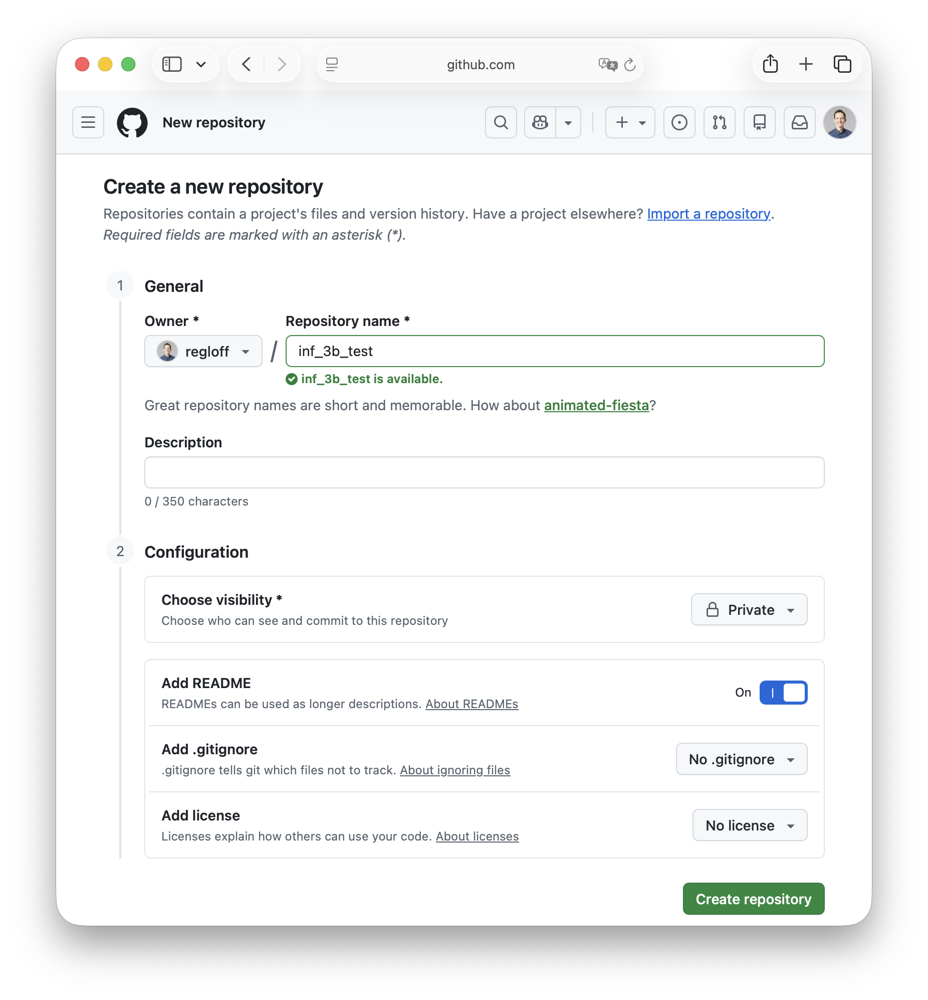
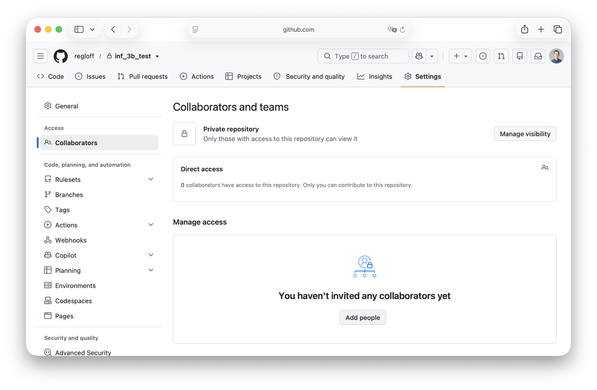
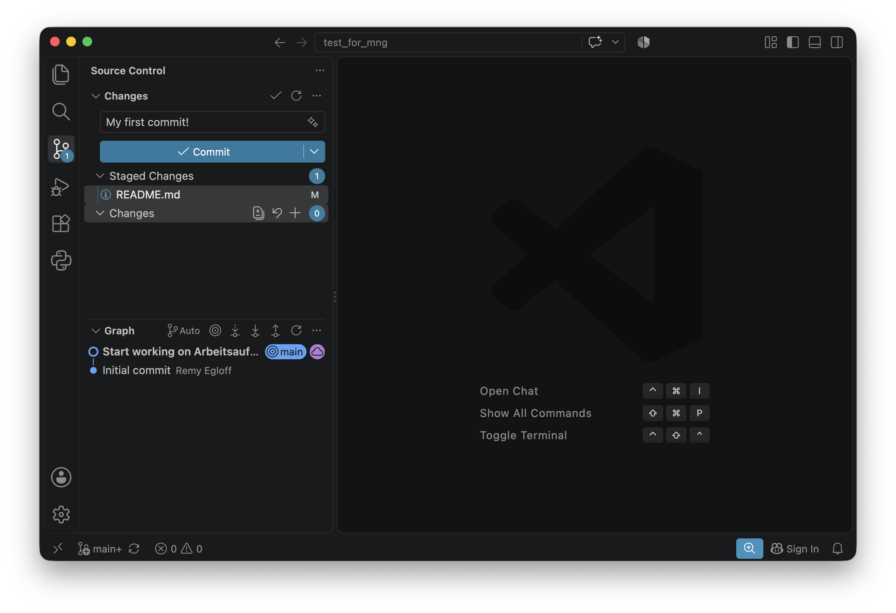
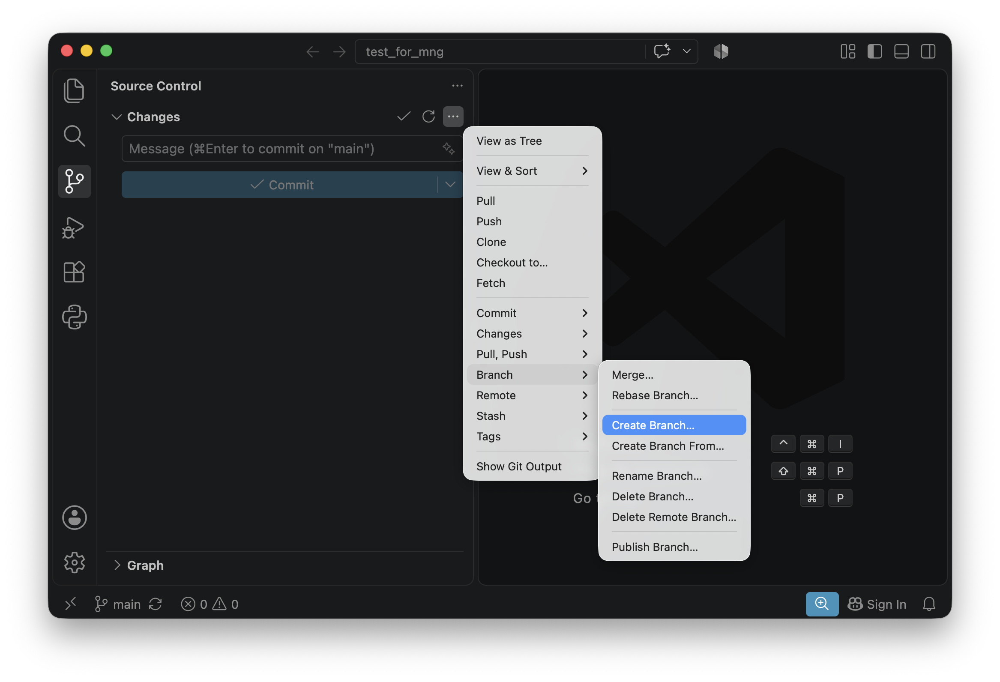

# Arbeitsauftrag "Erste Schritte mit Git / GitHub"
## Schritt 1: GitHub Repository erstellen
_Muss nur von einer Person der Gruppe gemacht werden_

Mit Git wird der Source Code einer Applikation in einem **Repository** verwaltet. Ein Repository besteht aus aufeinander aufbauenden **Commits**. Um ein **Repository** auf GitHub zu erstellen müssen folgende Schritte erfolgen:
- Sicherstellen, dass Sie auf [GitHub](https://github.com) eingeloggt sind.
- Auf GitHub oben rechts auf "+" und dann auf "New repository" klicken
- Einen Namen für das Repository eingeben
- Repositories können öffentlich zugänglich ("Public") oder nur mit Einladung einsehbar sein ("Private"). Für das Programmierprojekt wählen wir "Private".
- Bei "Add README" "On" anwählen. Ein README ist eine Datei, die ein Projekt kurz vorstellt und erklärt, wie man es nutzt oder einrichtet.



## Schritt 2: Gruppenmitglieder in das Repository einladen
_Muss nur von einer Person der Gruppe gemacht werden_
- Auf GitHub auf das neu erstellte Repository navigieren und oben "Settings" anwählen
- Unter "Collaborators" - "Add people" können die anderen Gruppenmitglieder und die Lehrperson "RouLee" hinzugefügt werden.
- Die hinzugefügten Personen sollten nun eine Einladung per Email erhalten haben



## Schritt 3: Repository lokal clonen
- Wenn ein Laptop verwendet wird: Falls noch nicht vorhanden, [Visual Studio Code](https://code.visualstudio.com/download) herunterladen & öffnen. 
- Wenn ein Laptop verwendet wird: Über das Terminal (Mac) oder PowerShell (Windows) Username & Email hinterlegen:
```
git config --global user.name "Max Muster"
git config --global user.email max@example.com
```
- Wenn ein Tablet verwendet wird: [https://vscode.dev](https://vscode.dev) öffnen
- Links "Source Control" anwählen und "Clone Repository" klicken
- Bei GitHub anmelden
- Das zuvor erstellte GitHub Repository auswählen und Speicherort definieren

## Schritt 4: Änderungen vornehmen & pushen
- Änderungen an README.md vornehmen oder neue Datei hinzufügen
- Mit "+" gewünschte Änderungen auswählen
- **Commit Message** schreiben. Die Beschreibung ist wichtig und soll klar zu erkennen geben, was für Änderungen in diesem Commit gemacht wurden.
- Mit einem Klick auf "Commit" wird ein Commit erstellt
- Mit "Sync Changes" werden alle neuen Commits auf GitHub übertragen. Dies nennt man **Git Push**.



## Schritt 5: Verifizieren, dass Änderungen auf GitHub übernommen wurden
- Auf GitHub zum erstellten Repository navigieren und überprüfen, ob neu erstellte Commits sichtbar sind


## Schritt 6 (Optional): Branching
Wenn mehrere Personen am gleichen Projekt arbeiten, kann das bisherige Vorgehen an seine Grenzen kommen. Auf GitHub gepushte Commits sind im Code direkt für alle Projektmitglieder sichtbar. Halbfertige Funktionen stören so möglicherweise andere Personen.

**Git Branches** ermöglichen es, parallel an mehreren Änderungen zu arbeiten: Man kann neue Funktionen entwickeln, Fehler beheben oder Ideen ausprobieren, ohne den stabilen Hauptstand zu stören. So lassen sich Änderungen gezielt prüfen und erst dann zusammenführen, wenn sie bereit sind.

In Visual Studio Code kann unter "Source Control" über das Kontextmenu ("...") ein neuer Branch erstellt werden.



Der aktuell ausgewählte Branch ist jeweils unten links sichtbar. Commits die jetzt erstellt werden, sind nur auf diesem Branch vorhanden. Wenn die Funktionalität  abgeschlossen ist, kann der Branch über das Kontextmenu über "Merge..." in den Hauptbranch ("main") **gemerged** werden.

**Auftrag**: Erstellen Sie einen neuen Branch, fügen sie mindestens zwei Commits hinzu und mergen sie den Branch wieder in den Hauptbranch "main".